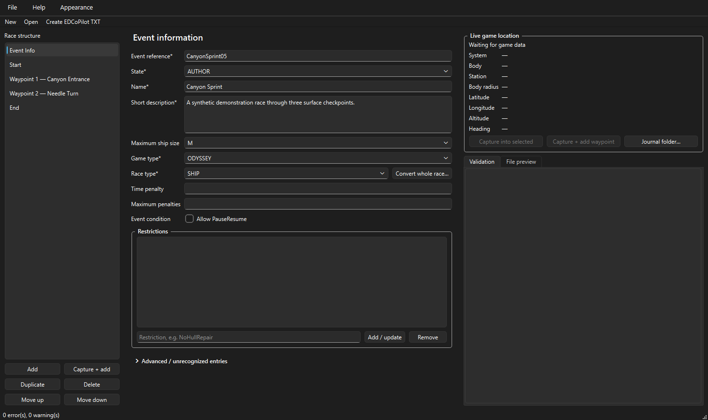
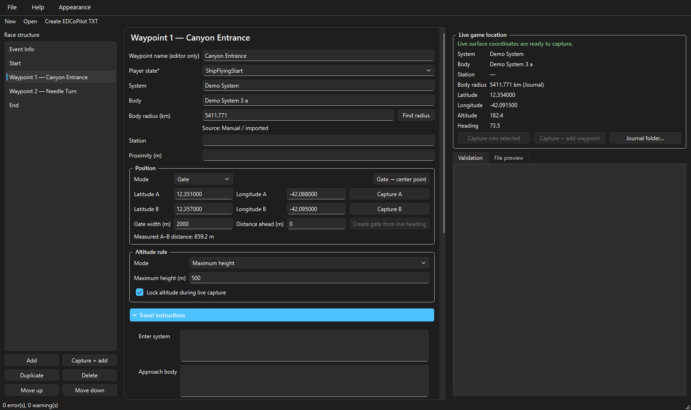
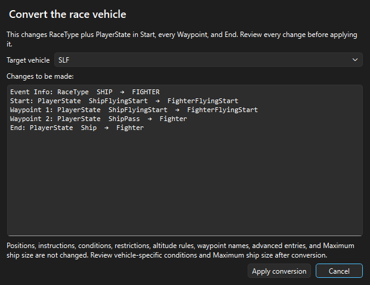

# EDTT Definer

**An unofficial time-trial editor for EDCoPilot.**

EDTT Definer is a native Windows editor for creating and maintaining EDCoPilot time-trial definition files. The current release is **v0.7.0**.

> **AI development disclosure:** This project was “vibe-coded” with OpenAI Codex. The project owner supplied the idea, requirements, EDCoPilot examples, testing feedback, and release decisions. Codex generated and revised most of the source code, automated tests, and documentation. The resulting application has been tested, but—as with any software, especially AI-generated software—it may still contain mistakes. See [AI_DEVELOPMENT.md](AI_DEVELOPMENT.md) for the full disclosure.

## Screenshots







## Run the application

### Prebuilt Windows release

Open the [latest GitHub release](https://github.com/LouisH99/EDTT-Definer/releases/latest), download `EDTT-Definer-v0.7.0.exe` from its **Assets** section, and run it. No installation is required.

The executable is not code-signed, so Windows SmartScreen may show its normal warning on first launch.

### Run from source with a virtual environment

```powershell
git clone https://github.com/LouisH99/EDTT-Definer.git
cd EDTT-Definer
py -3.13 -m venv venv
.\venv\Scripts\python.exe -m pip install .
.\venv\Scripts\python.exe -m edtt_definer
```

### Run from source with your system Python

```powershell
git clone https://github.com/LouisH99/EDTT-Definer.git
cd EDTT-Definer
py -3.13 -m pip install .
py -3.13 -m edtt_definer
```

Python 3.13 is required. Using a virtual environment is recommended because it keeps EDTT Definer and its dependencies separate from other Python programs.

## Basic workflow

1. Choose **File → New** or open an existing `*.export.txt` definition.
2. Complete Event Info, Start, any intermediate Waypoints, and End.
3. Add, duplicate, delete, or reorder waypoints from the left pane. Hold **Ctrl** to select separate waypoints or **Shift** to select a range, then duplicate, delete, or move the complete group together.
4. When Elite Dangerous is reporting surface coordinates, use **Capture into selected** or **Capture + add waypoint**.
5. Save the editable work with **Save Editable Project (.json)**. Each successful save creates the next time-trial version.
6. Resolve all red validation errors and choose **Create EDCoPilot TXT**. If the project changed, EDTT Definer asks you to save it first so the export matches a saved version.
7. Import the resulting `*.export.txt` through EDCoPilot's Time Trials page.

A new race starts with Waypoint 1 for convenience. Intermediate waypoints are optional: delete the final waypoint to create a direct Start-to-End race, or use **Add** later to restore Waypoint 1.

### Lap/section dividers and reverse laps

Use **Section…** to place an editor-only named divider immediately before the active waypoint, for example `Lap 2` or `Canyon section`. Double-click a divider to collapse or expand all of its waypoints. Collapsing is a temporary view choice and never changes the project or EDCoPilot fields. Section names can appear only as context in generated `EDTTD` waypoint-name comments. Select a divider and use **Section…** to rename it, or use **Delete section** to remove only the divider.

When a divider is selected, **Duplicate** changes to **Duplicate section**. It copies every waypoint from that divider up to the next divider and places the complete copy immediately after the original. Numbered labels advance to the next unused number, so duplicating `Lap 1` when `Lap 2` already exists produces `Lap 3`.

**Add** and **Capture + add** insert the new waypoint immediately after the active waypoint. When Event Info, Start, or End is active, the waypoint is added at the end of the route.

To create a reverse lap, select one continuous waypoint range with Ctrl or Shift, choose **Duplicate**, and then choose **Reverse** while the copied group remains selected. The complete waypoint blocks are reversed without changing their coordinates, names, altitude rules, conditions, instructions, comments, unknown entries, or capture metadata. Divider boundaries remain at their route positions.

Reversal does not reinterpret heading/direction conditions, gate endpoint order, or spoken instructions. The confirmation shows the exact order before and after and reminds the author to review direction-specific content.

### Grouped validation results

Repeated identical errors or warnings are shown as one collapsed validation group with the number of affected waypoints, rather than repeating an indistinguishable message for every waypoint. Double-click the group to reveal the numbered and named waypoints responsible, then double-click a child row to open that waypoint. Unique validation results remain unchanged.

### Convert the whole race vehicle

Use **Convert whole race…** beside Race Type to change a complete course between Ship, SLF, SRV, and On Foot. The confirmation window lists every `RaceType` and `PlayerState` change before anything is applied.

Ship conversion preserves an existing ship or SLF flying start. Otherwise it creates a landed Ship start and uses `ShipPass` for route waypoints. SLF conversion uses `FighterFlyingStart` for Start and, when one exists, Waypoint 1. SRV and On Foot apply their matching state to every stage.

Only `RaceType` and `PlayerState` are changed. Positions, altitude rules, instructions, conditions, restrictions, waypoint names, advanced entries, and Maximum ship size remain untouched. Review vehicle-specific conditions and Maximum ship size after converting.

The Start section is also checked against Event Info's `RaceType`. A mismatch is shown as a validation warning and must be explicitly confirmed before export, helping catch a race whose vehicle conversion was only partly completed. Flying-start PlayerState choices are offered only for Start and Waypoint 1; imported values elsewhere remain visible and are preserved until changed.

### Live 3D course view

The **Course view** tab shows Start, every valid point or gate, End, route lines, altitude bounds, and—when its System and Body match—the live player position and heading. Start and End always have labels; hover over or select a waypoint to see its name, coordinates, altitude rule, proximity, and PlayerState.

The canvas uses a RaceViz-inspired dark presentation: Start is green, waypoints are yellow, End is blue, and selected checkpoints are light blue. Checkpoint volumes are translucent and retain their true gate width and 1:1 altitude scale. This presentation was adapted with the RaceViz author's explicit permission; see [THIRD_PARTY_NOTICES.md](THIRD_PARTY_NOTICES.md).

### Race-line recording

The Course view can record the current vehicle path while Elite Dangerous is running:

1. Select the course body and make sure it has a valid positive `BodyRadius`.
2. Choose **Record**. Recording waits safely if live surface coordinates are unavailable or belong to another System/Body.
3. Use **Pause** and **Resume** to create an intentional gap, or **Stop** to finish while keeping the line visible.
4. Save the result as `*.edtttrace.json` to preserve exact coordinates, timing, segments, and body context. Choose CSV to create a RaceViz-compatible `#Version3` file.

Speed is derived from great-circle surface distance, altitude change, and elapsed recording time. The line is colored from cyan at lower speed through peach to red at the fastest recorded point. Unchanged snapshots are not duplicated, and missing/stale/mismatched data starts a new segment instead of drawing a false straight line. Recording never changes the time-trial project or EDCoPilot TXT output.

**Open trace…** accepts EDTT trace JSON and EDCoPilot/RaceViz `#Version2` or `#Version3` CSV. Because CSV does not contain System or Body names, an imported CSV is associated with the body currently selected in the Course view. Legacy `#Version1` CSV can be opened when the selected course supplies its missing body radius.

Courses are grouped by normalized System and Body. Use the **Body** selector when a definition spans more than one body; choosing a section in the editor automatically selects its body. The visualizer uses the first valid project `BodyRadius` in route order, followed by matching live or locally cached data. Conflicting project radii produce a warning. Without an accurate radius, the view waits instead of inventing a planetary scale.

For a complete single-body route, Course view shows an accurate checkpoint-to-checkpoint surface distance from Start through every waypoint to End. Gate checkpoints use their spherical midpoint. Altitude and the driver's actual chosen path are intentionally excluded, so this is a course-definition distance rather than a recorded racing-line distance.

The default view is automatically fitted and looks down at the course from a 45-degree angle, with North toward the top and East to the right. This deterministic overview is restored when a project is opened or a different body is selected. Enable **Follow ship** to track the matching live position at the same 45-degree tilt; with **Lock center at 0 m**, the ground directly below the vehicle stays centered, while disabling the lock centers the vehicle itself. The camera rotates with live heading so the vehicle initially points toward the top of the view. While following, left-drag freely changes the heading-relative camera angle without releasing the ship, and Shift + left-drag changes roll. Click **Follow ship** again to rotate the following camera another 90 degrees around the vehicle, cycling through side, rear, and opposite-side views. Follow mode waits safely if matching coordinates are temporarily unavailable. Zoom remains available while following; right- or middle-drag panning, **Top**, or **Fit** turns following off.

Drag with the left mouse button to orbit from directly above, through a side view, to directly below the course. Horizontal mouse orbit uses the same direction as EDTT Definer v0.6.6. Normal orbit stops at the two vertical poles instead of crossing them and flipping the scene, horizontal yaw still reaches every side, and positive altitude remains above ground throughout. Hold **Shift** while left-dragging to roll the camera intentionally. Press **R** to restore upright roll or **Shift + R** to turn the view 180 degrees; only explicit roll can turn altitude upside down. Drag with the right or middle button to pan and use the mouse wheel to zoom. Double-click Start, a waypoint, or End to select it and center the camera on that checkpoint. **Lock center at 0 m** is enabled by default and constrains the camera pivot to the ground plane: panning moves that pivot across the surface while its altitude remains exactly zero, even in a rolled or side-on view. Up/down movement is gradually reduced as the view becomes more horizontal, preventing large surface-distance jumps near a side view. Disable the lock to pivot and pan at checkpoint altitude. **Top** restores the fitted straight-down overview and clears camera roll, while **Fit** frames all visible route geometry without changing the current angle. The distance scale and altitude geometry use the same physical metre scale without vertical exaggeration.

Choose **Pop out** to move the same live panel into a separate, resizable, non-modal window. **Dock back**, the tab placeholder, or closing the separate window returns it to the main editor. Camera movement, body selection, and docking never modify the course or mark it as changed.

For a manually captured gate, choose **Gate** in the position editor and capture endpoint A and endpoint B separately, in either order. A B-first capture is retained as incomplete project data, but EDCoPilot export remains blocked until A is also present. Once both endpoints and the body radius are present, the editor displays their great-circle surface distance in metres or kilometres. This measurement is informational and is not added to the EDCoPilot TXT. Altitude is locked against live capture by default, so capturing either endpoint does not replace the chosen rule. Unlock it when live altitude should update a target; the app intentionally does not invent an altitude tolerance.

### Convert a gate to its center point

A complete gate can be changed into one point by choosing **Convert gate to centered point**. EDTT Definer calculates the spherical midpoint of the shorter great-circle path between endpoints A and B, shows the result for confirmation, and then replaces only the stage's `Position`. This works correctly across the ±180° longitude seam and at high latitudes and does not require a body radius.

The existing Proximity value is preserved rather than invented or changed. A converted point must have a positive Proximity before it can be exported. Altitude rules, instructions, conditions, waypoint names, and advanced entries are also preserved. Exactly antipodal endpoints cannot be converted because they do not have one unique spherical midpoint.

### Collapsible sections, themes, and field help

Less frequently used form areas can be collapsed with their arrow headers. **Advanced / unrecognized entries** and **Maximum-speed rule** start closed; **Travel instructions** and **Conditions** start open. The application remembers these choices. A populated section shows an entry count in its header, and a closed section is highlighted if it contains a validation error.

Use **Appearance → Follow Windows**, **Light**, or **Dark** to choose the interface theme. Follow Windows is the default, and an explicit choice is remembered. Hover over a field or button for about two seconds to see its purpose, accepted values, consequences, and examples where useful. Player-state help explains every supported state and the special first-waypoint rules for flying starts. The same descriptions are exposed to accessibility tools.

### Update checks

EDTT Definer checks the public GitHub Releases API shortly after startup so it can report a newer stable version. Disable this with **Help → Check for updates automatically**, or run **Help → Check for Updates…** at any time. An available update can be opened in the browser, postponed, or skipped. The application never downloads or installs updates itself.

Startup connection failures are silent. Manual checks report connection, response, and GitHub rate-limit errors. A skipped version remains hidden during automatic checks but is still reported by a manual check.

### Stage aliases, time-trial versions, and altitude rules

Start, Waypoints, and End can have optional editor aliases, displayed as labels such as `Start — Crater Entrance` or `Waypoint 3 — Canyon Gate`. Aliases are stored in the editable `*.edttc.json` project and included in EDCoPilot TXT exports only as standalone namespaced comments:

```text
[waypoint]
<!-- EDTTD: (Round 1) WP1 — Canyon Entrance -->
PlayerState=SRV
```

Every waypoint receives a numbered comment so it can be matched to the editor. An unnamed waypoint is exported as `<!-- EDTTD: WP1 -->`; section context and an alias are added when available. EDTT Definer restores aliases when one of its exported TXT files is reopened. The comments do not add or replace EDCoPilot fields.

The top of the Race structure pane shows the time-trial version and last-saved time. Every successful Save or Save As increments the version, including an unchanged save; exporting never increments it. New exports include the saved version and timestamp in an `EDTTD` comment after `[event]`. Creating an export never marks the editable project as changed.

Each stage offers three altitude modes: no restriction, a maximum height, or a target altitude with a tolerance. Maximum height is an authoring shortcut: a maximum of `500` metres is exported as `Altitude=250` and `AltitudeProximity=250`, representing the permitted range from zero through 500 metres. Maximum-height values are always manual and are never replaced by live capture.

New races start with `MaxShipSize=N/A`. Their initial stages and newly added waypoints start in Maximum height mode with altitude locking enabled; enter the intended maximum before exporting, or select a different altitude mode.

When a waypoint uses Maximum height, the next waypoint added after it inherits the same maximum. Changing that new waypoint's maximum changes what the following waypoint inherits. Target and No restriction modes are not converted into inherited maximums.

Closed selection lists ignore the mouse wheel, allowing the surrounding form to scroll without accidentally changing Race Type, altitude mode, PlayerState, or another choice. Open lists and keyboard selection continue to work normally.

### Calculated gates from live heading

The editor can calculate a gate perpendicular to the ship or SRV's live heading:

1. Select Start, a Waypoint, or End. Let the editor discover `BodyRadius`, choose **Find radius**, or enter it manually in kilometres.
2. Wait for live latitude, longitude, and heading to appear.
3. Enter the total **Gate width** in metres. The default is `2000`.
4. Leave **Distance ahead** at `0` to center the gate on the current position, or enter a positive distance in metres to place its center ahead of you.
5. Choose **Create gate from live heading** and review endpoints A and B before exporting.

The calculation uses spherical destination geometry. A centered gate places half its width to the left of the heading and half to the right. Width, forward offset, body radius, center, heading, and calculated endpoints are retained in the editable project's capture metadata but only the EDCoPilot `Position` gate is exported.

### Automatic body radius

Elite Dangerous journal `Scan` events contain a body's radius in metres. EDTT Definer converts that value exactly to kilometres, caches it locally, and uses it for a matching live system and body. The source is shown as **Journal** or **Local cache** beside the field. An existing imported or manually entered `BodyRadius` is never overwritten automatically.

If no local radius is available, **Find radius** can use the public [EDSM](https://www.edsm.net/) system-bodies API. The first lookup asks whether to allow it once, always allow it, or not use it at that time. An allowed lookup sends the system name to `edsm.net` over HTTPS; the current body is matched locally in the returned body list. EDSM responses are cached and marked as **EDSM** or **EDSM cache**. Use **Help → Reset EDSM radius permission** to make the application ask again.

Start, waypoint, and end forms also expose the instruction and timing fields found in EDCoPilot examples, including `EnterSystemInstruction`, `ApproachBodyInstruction`, `LastLegMessage`, `EndInstruction`, and the `MaxSpeed*` settings. Repeated instructions use one large free-form editor: each non-empty line becomes a separate instruction entry, and a line can begin with `Terse:` for EDCoPilot's shorter speech mode. **Insert Terse:** prefixes the current line or every selected non-empty line and leaves already-prefixed lines unchanged. The End section uses `EndInstruction`; `NextInstruction` is only used by Start and Waypoint sections.

## Game data

The normal journal location is detected automatically:

```text
%USERPROFILE%\Saved Games\Frontier Developments\Elite Dangerous
```

Use **Journal folder…** in the live-location pane if the folder has been redirected. A stale status or “no planetary coordinates” message is normal when the game is closed, at the main menu, or away from a planetary surface.

The application watches `Status.json` and reads it only at startup or when Windows reports a file change. Because Elite replaces the file during updates, EDTT Definer also watches the containing directory and automatically attaches to each replacement. The course map keeps the session's last known valid marker when the file becomes stale, temporarily missing, or partially written; a valid update without planetary coordinates or changing the journal source clears it. Capture and race-line recording remain stricter and require a current valid reading, so a retained map marker can never be captured as if it were live. Freshness is based on actual file changes rather than the embedded game timestamp, which can lag behind the PC clock. It watches the newest `Journal.*.log` for current system, station, body identifiers, locally available scan radii, and journal rotation. Change bursts are briefly debounced; files are read locally and never modified.

## Development

```powershell
py -3.13 -m venv venv
.\venv\Scripts\python.exe -m pip install -e ".[dev]"
.\venv\Scripts\python.exe -m edtt_definer
.\venv\Scripts\python.exe -m pytest
```

After installation, the application can also be started with `edtt-definer` from the activated virtual environment.

## Building the executable

```powershell
.\build.ps1
```

The unsigned executable is written to the `dist` directory using the versioned name configured in `build.ps1`.

See [CHANGELOG.md](CHANGELOG.md) for release notes.

The project repository is [LouisH99/EDTT-Definer](https://github.com/LouisH99/EDTT-Definer). Bugs and feature requests can be submitted through [GitHub Issues](https://github.com/LouisH99/EDTT-Definer/issues).

## Files

- `*.edttc.json` is the schema-v4, versioned editable project format. Older project schemas load automatically. Do not import it into EDCoPilot.
- `*.export.txt` is the validated plain-text EDCoPilot import format.
- `*.edtttrace.json` is the independent, exact race-line recording format.
- `*.csv` race-line files use the EDCoPilot/RaceViz trace syntax and can be exchanged with compatible visualization tools.

The application reads Elite Dangerous telemetry locally and does not automate EDCoPilot. It contacts EDSM only after the user permits the optional body-radius fallback described above. When automatic update checks are enabled, it also requests the latest public release metadata from GitHub; no project or game data is sent.

## License

EDTT Definer is released under the [MIT License](LICENSE).

Elite Dangerous, EDCoPilot, and their respective names and assets belong to their respective owners. This project is an independent community tool and is not affiliated with or endorsed by Frontier Developments or EDCoPilot.
